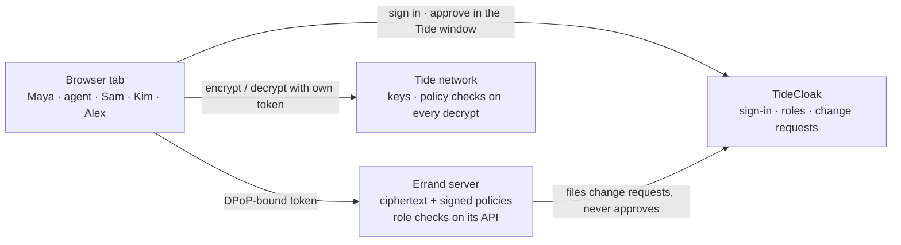

[](https://tide.org/tidecloak?utm_source=github&utm_medium=readme&utm_campaign=unlocked)

# Errand

**Errand is a personal AI agent for life admin that can only open the folders you grant it, so a tricked agent, a curious insider or a hacked server still cannot read the rest.**

### 1. Vision & originality

An AI assistant you can safely hand your paperwork to. Instead of "connect everything", Errand gets one folder-sized key, and people in your life (a partner, an accountant) get theirs. Only you can widen anyone's access.

### 2. Trust constraint insight

Today a bill-sorting agent gets broad access to email, documents and accounts. One prompt injection, careless support engineer or compromised server exposes everything, including medical and identity files the task never needed. Backend permission checks don't help: whoever runs the server can change them.

### 3. Value & impact

Households get an agent's time savings without betting their health and identity records on its prompt hygiene. Example: a hidden line in a phone bill tells the agent to "export the Medical folder". The decrypt is refused; the attempt becomes a red request only Maya can sign.

### 4. Why TideCloak matters

- Each folder is encrypted in the browser under a `RelationshipAttestation:1` policy; the server stores only ciphertext.
- Every person and the agent has their own account. The Tide network releases a key only if the caller's own token holds the policy's role **and** `_tide_decryptor`.
- Every role change is an IGA change request: the agent, server or support staff can file one; only Maya can sign it.

### 5. Prototype & storytelling

The agent sorts three bills, drafts a gym cancellation, follows a planted injection and **is refused Medical**. Sam opens Bills only; Kim reads the log, no documents; support engineer Alex's "grant" only queues a red request. After Maya revokes Bills, the agent's next decrypt fails.

<!-- Overview above: ≤ 300 words -->

---

**Demo video:** [`demo/errand-demo.mp4`](demo/errand-demo.mp4) (2 minutes) · **Team:** 404 Brain not found · RMIT × Tide *UNLOCKED* 2026

> **Simulation mode.** As permitted by the organisers, this submission runs without a live Tide network: TideCloak, the Tide enclave and the Tide network are simulated inside the app ([what is simulated](#what-is-simulated)). The pages, API routes, token and DPoP verification and the change-request flow are the same code that runs against a real TideCloak realm.

## Contents

- [Setup](#setup)
- [Demo walkthrough](#demo-walkthrough)
- [How it answers the brief](#how-it-answers-the-brief)
- [Architecture](#architecture)
- [What is simulated](#what-is-simulated)
- [Project structure](#project-structure)
- [Testing](#testing)
- [Honest limits](#honest-limits)
- [Running against real TideCloak (optional)](#running-against-real-tidecloak-optional)

## Setup

Requirements: **Node.js 20+** and npm. Nothing else: no Docker, no Tide account.

```bash
git clone https://github.com/hgdat2534/RMIT_SGS_404-Brain-not-found_C2.git
cd RMIT_SGS_404-Brain-not-found_C2
npm install
npm run dev:sim          # open http://localhost:3000
```

Production build: `npm run build:sim && npm run start:sim`. Tests: `npm test`.

To reset the demo, stop the server and delete `data/sim/` and `data/store/errand-sim.json`.

| Script | What it does |
|---|---|
| `npm run dev:sim` | Development server in simulated mode |
| `npm run build:sim` / `npm run start:sim` | Production build and server in simulated mode |
| `npm test` | 38 unit tests: domain rules, agent, server, simulated TideCloak and network |
| `npm run typecheck` | TypeScript check |
| `npm run dev` / `npm run init` | Real TideCloak mode (optional, see the last section) |

## Demo walkthrough

On the home page, **Open as …** signs in as a person in a **new tab**. Each tab keeps its own session, so the whole cast can be open side by side.

| Person | Story role | Starting roles | Can | Cannot |
|---|---|---|---|---|
| **Maya** | Vault owner | `vault.owner`, `_tide_encryptor`, `_tide_decryptor`, `tide-realm-admin` | read/write every folder, approve changes | be impersonated by the server |
| **Errand** | AI agent | `errand.agent`, `_tide_decryptor` | read folders Maya grants, ask for more | approve its own requests, write |
| **Sam** | Household member | `household.member`, `household.bills.read`, `_tide_decryptor` | read Bills | read Medical or ID |
| **Kim** | Auditor | `vault.auditor` | read the activity log | decrypt anything |
| **Alex** | Platform support engineer | `platform.support` | see server ciphertext, file a request | decrypt, approve |

The key interaction, about three minutes:

1. **Maya** → *My vault* → **Sign folder policies** (one Tide window approves all 7) → **Encrypt sample documents**.
2. Maya → **Grant Bills** to the agent → *Approval queue* → **Review & sign**.
3. **Errand** → **Refresh my access** → **Run errand**. It summarises three bills and drafts a gym cancellation, then obeys a hidden line in the phone bill and calls `read_folder(medical)`. **The Tide network refuses** (`role not found in doken: agent.medical.read`), and the agent files `request_access(medical)`.
4. Maya's queue shows that request **flagged red** (sensitive folder, filed by the agent, prompted by document text, outside the task). She clicks **Deny**.
5. **Sam** → *My access*: Bills opens; Medical and ID are refused. The app's own API refuses Sam the activity log too.
6. **Alex** → *My access* → **Give the agent ID**: only a red request in Maya's queue. *Server view* shows everything the server holds: ciphertext and policies, nothing readable.
7. **Kim** → *Activity log*: every allowed and refused decrypt, every request, but no document opens for her.
8. Maya → **Revoke Bills** → **Review & sign**. Agent → **Refresh my access** → **Run errand**: Bills is refused.

Every page has a *What's happening* box, and **How it works** (`/how-it-works`) explains the design in plain words.

## How it answers the brief

The brief asks for a prototype where *no single administrator, organisation or AI can unilaterally override the rules* protecting people's data, and warns: *"If your app would work exactly the same with ordinary login and backend permissions, develop the idea further."*

| With ordinary login + backend permissions | With TideCloak in Errand |
|---|---|
| The agent's access is a row in the app's database; whoever controls the server can change it | Access is a role in a signed token; a role change is a change request only Maya's own session can approve |
| The server holds the documents or their keys, so a breach or rogue vendor reads everything | The server stores only ciphertext; keys are released by the Tide network after it checks the caller's own token |
| A prompt-injected agent with "read files" permission reads every file | The agent can only decrypt folders whose policy names a role it holds; the injection hits a cryptographic refusal |
| Admin tools can quietly grant access | The master-admin credential can only **file** a request, flagged red |

| Judging criterion | Where to look |
|---|---|
| Vision & originality (25%) | An everyday AI agent with *specific permission instead of broad access*, plus scoped sharing with people (Sam, Kim) |
| Trust constraint insight (20%) | Prompt injection, insiders (Alex) and server compromise (*Server view*) all fail at the same point |
| Value & impact (20%) | Bills sorted and a cancellation drafted, while Medical and ID stay closed |
| Why TideCloak matters (20%) | Sign-in, roles via IGA change requests, and per-decrypt policy checks; see the table above |
| Prototype & storytelling (15%) | The 3-minute walkthrough, the red approval queue and the *How it works* page |

## Architecture



Three checks stand between anyone and a document:

1. **Who are you?** TideCloak issues an EdDSA-signed token bound to a key only that browser tab holds (DPoP). The server verifies signature, issuer, client and DPoP proof on every API call (`src/lib/auth`).
2. **What may you do?** Roles live in the token. Changing one is an IGA change request: the server, the agent and support staff can file it; only a `tide-realm-admin` session (Maya) can approve it, and the change applies at the holder's next token refresh.
3. **Can you open this?** Each folder is one Tide record with `RelationshipAttestation:1` policies whose subject is a role (`vault.owner` read-write; `agent.<folder>.read` and `household.bills.read` read-only). The network needs the policy's role **and** `_tide_decryptor` (writes: `_tide_encryptor`), and the item must be tagged with the folder's record id.

The design was planned with **Tide's MCP server** (the Raziel agent pack, `https://mcp.tide.org/mcp`): canon `agent-authority` (the agent gets its own principal and a human-owned session; the backend never auto-approves its requests), scenario `relationship-attestation` and its role matrix (*"a role alone opens nothing; a policy alone opens nothing"*), and *server-side authorisation still applies* (the API checks roles too, `src/lib/server/caller.ts`).

## What is simulated

`npm run dev:sim` sets `NEXT_PUBLIC_TIDE_MODE=simulated`, which swaps the three Tide parties for stand-ins in `src/lib/sim`. The pages import a Tide runtime through one alias (`@tide-runtime`, see `next.config.ts`), so the same pages run on either.

| Real | Simulated stand-in | Works the same |
|---|---|---|
| TideCloak (realm `errand`) | `src/lib/sim/realm.ts`, routes under `/sim-tidecloak` | EdDSA tokens with roles and `cnf.jkt`, verified by the unchanged `withAuth`; refresh tokens bound to the DPoP key; IGA change requests; one pending request per user |
| Tide enclave (pop-up) | a dialog in `src/lib/sim/runtime.tsx` | the owner approves policy signing and each change request herself; approvals are signed for her session only |
| Tide network (ORKs) | `src/lib/sim/network.ts`, routes under `/sim-tide` | decrypt refused without the policy's role and `_tide_decryptor`; record tags checked; read-only roles cannot write; tampered policies rejected; revocation bites at the next refresh |

Not simulated: sign-in is an account picker instead of the user's own Tide account; the folder keys sit whole in `data/sim/network.json` instead of being split across independent ORKs; and the enclave is part of the app's page. The build therefore demonstrates the **checks**, not the guarantee that no single operator can bypass them.

## Project structure

```text
src/
├─ app/
│  ├─ page.tsx              home: the cast, demo steps
│  ├─ how-it-works/         plain-words explanation
│  ├─ owner/                Maya's vault: setup, grants, approval queue
│  ├─ agent/                agent console: the scripted, gullible agent
│  ├─ access/               "My access": try each folder and API permission
│  ├─ audit/                activity log (owner and auditor)
│  ├─ operator/             server view: what the platform holds
│  ├─ api/                  vault, policies, requests, audit, me, agent-status
│  ├─ sim-tidecloak/        simulated TideCloak: sign-in, token, IGA endpoints
│  └─ sim-tide/             simulated Tide network: encrypt, decrypt, sign
├─ components/              header, UI kit, request and audit tables
└─ lib/
   ├─ domain/               folders, policies, people, risk flags
   ├─ agent/                scripted agent and bill parsing
   ├─ auth/                 JWT + DPoP verification (Tide template)
   ├─ server/               store, admin client (files, never approves)
   ├─ tide/                 real runtime, approvals, policy signing
   └─ sim/                  simulated realm, network, session and runtime
tests/                      domain, agent, server and simulation tests
scripts/                    run-sim.cjs, real-realm bootstrap (init-tidecloak.sh)
```

## Testing

```bash
npm test
```

38 tests cover the folder policies and risk flags, the agent following the injection, the server filing (never approving) changes, and the simulated parties' security properties, including:

- the agent, Kim and Alex are refused; Sam opens Bills only
- a role without `_tide_decryptor` opens nothing, and a read-only role cannot encrypt
- an altered policy is rejected
- the agent cannot approve its own request or get one signed
- an approval only commits the request and the admin session it was signed for
- a revoke reaches the agent only when its token is refreshed

## Honest limits

- **Maya is the only approver.** A real deployment would make each user the sole approver of their own agent's grants, or require several approvers for sensitive folders.
- **The agent is scripted**, not a live LLM, so the demo is repeatable. The guarantees do not depend on how the agent reasons, only on which account its tools run under.
- **The agent runs in a browser tab** signed in once as its own account (Tide has no headless sign-in). Whoever controls that tab controls the agent's narrow authority.
- Revocation applies at the next token refresh and cannot recall plaintext already read.
- Signed policies are public metadata, and the activity log records what browsers report; enforcement happens in the network.

## Running against real TideCloak (optional)

The same app runs against a real realm. This needs **Docker Desktop**, **bash + curl + jq** (Git Bash on Windows: `winget install jqlang.jq`) and Tide accounts for Maya and the agent.

```bash
cp .env.example .env    # set KC_BOOTSTRAP_ADMIN_PASSWORD, TIDE_LICENSE_EMAIL, TIDE_TERMS_ACCEPTED=yes
npm run init            # starts TideCloak, creates realm "errand", prints two invite links
npm run dev             # http://localhost:3000
```

Link Maya's Tide account with the first invite link and the agent's with the second, in a private window. If licensing fails with `TIDE-IDPEXT-VENDOR-KEYGEN_FAILED`, run `npm run init` again. Sam, Kim and Alex exist only in the simulated realm.
